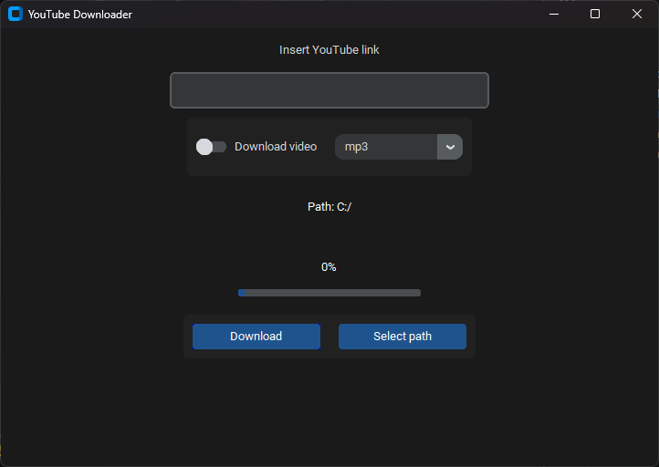
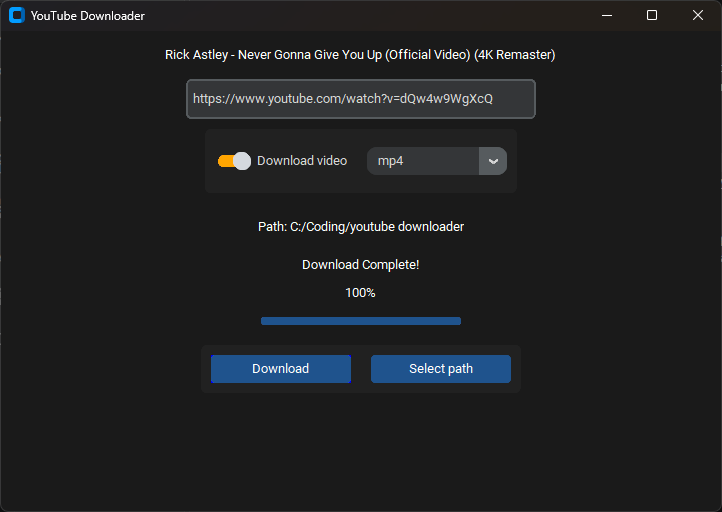

<h1> YouTube Downloader </h1>


[](https://choosealicense.com/licenses/mit/)


This repository provides a simple tool to download YouTube videos, in both video and audio, or only audio format. It is built using the Python library yt-dlp and the GUI using cusotomtkinter. 

## How to use

Once you have set it up, simply paste the link of the video you want to download,  and press the button! Simple as that.

|  |  | 
| --- | --- |
|  |  |
| | |

You can change the path where the downloads are stored, using the "select path" button. The defaul folder is set to the users's "Download" path.

Enable the option to download video or audio only. 
The supported formats for the audio output are:
- mp3
- webm

The supported forts for the video output are:
- mp4
- webm
- mkv


## Installation

### Pre-requisits

To run the program and download videos, **Ffmpeg** is required to be installed and added to the PATH of your machine. You can check if it is installed on your system using the command `ffmpeg -version`. 

The software can be downloaded for free on the [official page](https://ffmpeg.org/download.html). Once you have downloaded and installed it, make sure to add it executable to the environment variable PATH, so it can be accessed and used through the command line.

### Running

To simply run the program, once you made sure that ffmpeg is installed on your device, you can download the executable from the release section of this repository. 

If you want to run from source code, clone the repo and install the required packages on a dedicated Python environment.

1. Clone the repo
```bash
git clone https://github.com/adb-coding/ytdownloader.git
cd ytdownloader
```
2. Create the virtual environment and activate it (either using uv or the classic pip package managers)

```bash
python -m venv venv-name
# uv venv venv-name             # if using uv package manager
venv-name\Scripts\activate      # on windows
# soruce venv-name/bin/activate   # on linux
```

3. Install the packages

```bash
pip install -r requirements.txt 
# uv pip install -r requirements.txt  # using uv
```


The code is all contained in one script, `ytdownloader.py`. Run it to access the UI and download your videos. 

4. Run the script

```bash
python ytdownloader.py
# uv run ytdownloader.py
```

### Build the executable

If you want to rebuild the executable, once you made some modifications to the source code, make sure to have installed **PyInstaller** in your virtual environment. 

```bash
pip install -U pyinstaller
```

Then proceed with the build of the .exe file  
```bash
pyinstaller --clean --onefile --windowed --icon=assets\ytdownloader.ico --add-data "assets\ytdownloader.ico;assets" ytdownloader.py
```

It will be in the `dist` folder.

## Known issues

- The yt-dlp package right now requires a javascript runtime to bypass the anti bot detection on YouTube side. The package `yt-dlp-ejs` overcome this problem, but in the future it might discontinue or stop working. Due to this, the long term stability is not granted, and future YouTube updates and more stringent bot detection interaction might brake the script.
- The --add-data flag, while using PyInstaller, still gives the default customtkinter icon, despite passing the custom icon.
- The .mkv extension is still not tested, and might produce .webm formats. 

